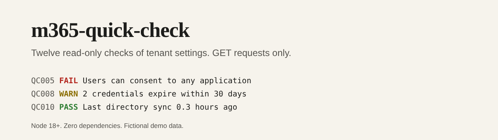

# m365-quick-check



[](https://github.com/pJijesh/m365-quick-check/actions/workflows/test.yml) [](LICENSE)  

**Problem:** the settings that decide how exposed a Microsoft 365 tenant is, such as who can invite guests, whether users can consent to any app, and which app secrets are about to expire, sit in several admin pages that nobody visits after the first week.

**For:** IT managers and small IT teams who want a five-minute, read-only look at tenant settings, with a plain-English reason and fix for each finding, and without installing a module or handing a script write access.

**Demonstrates:** a read-only Microsoft Graph client that can only send GET requests, twelve checks written as pure functions over a snapshot, tests against a local fake Graph server so no tenant is needed, and a token that is handled so it never reaches a log, a file or an error message.

## What it does

- **Twelve checks** over seven Graph endpoints: guest invitations, guest access level, who can register apps, who can create tenants, user consent to applications, the admin consent workflow, security defaults, expiring app secrets and certificates, unused licences, directory sync health, authentication methods, and notification contacts. Each has a rule, a reason and a fix in [`docs/checks.md`](docs/checks.md).
- **Honest results**: pass, warn, fail, info, or not assessed. If a permission is missing or an endpoint errors, the check says so and is never counted as a pass.
- **Three reports**: text, Markdown (with a "what to do" section) and JSON.
- **Offline mode**: save a snapshot once, evaluate it later or elsewhere, and evaluate it as of a different date.
- **Read-only by construction**: three `.Read.All` scopes, one HTTP method, and a test that fails if either changes. See [`docs/permissions.md`](docs/permissions.md).

## Install

Requires Node 18 or later. There is nothing to install: clone the repository and run it.

```bash
git clone https://github.com/pJijesh/m365-quick-check
cd m365-quick-check
node bin/m365-quick-check.mjs demo          # fictional tenant, no network, no sign-in
```

For a real tenant, give it a read-only access token for your own session in an environment variable. How to get one, and what the three scopes are, is in [`docs/permissions.md`](docs/permissions.md).

```bash
export GRAPH_ACCESS_TOKEN='...'
node bin/m365-quick-check.mjs run
node bin/m365-quick-check.mjs run --format md --out report.md
node bin/m365-quick-check.mjs run --save snapshot.json      # keep the data, privately
node bin/m365-quick-check.mjs check snapshot.json --now 2027-01-01T00:00:00Z
```

The token is read from the environment only. It is not accepted as an argument and it is never written anywhere.

## How it works

```text
token (env) -> 7 GET requests -> snapshot -> 12 pure checks -> text / Markdown / JSON
                  |                 |
        same-origin paging,   section status per endpoint:
        retry on 429, no       ok, denied, unavailable, error
        redirects
```

On the bundled fictional tenant:

```text
$ node bin/m365-quick-check.mjs demo
QC003  WARN  Who can register applications: Every user can register applications.
QC005  FAIL  User consent to applications: Users can consent to any application for any permission that does not need admin consent.
QC008  WARN  Application secrets and certificates: 2 credential(s) expire within 30 days: Fernwood HR sync (18d), Fernwood reporting (23d). ...
...
12 checks: 1 fail, 5 warn, 5 pass, 1 info, 0 not assessed (data collected 2026-11-12T09:00:00.000Z)
```

The full Markdown report for the demo is [`examples/report.md`](examples/report.md), and the snapshot it came from is [`examples/snapshot.json`](examples/snapshot.json).

## How it is built

```text
.
├── bin/m365-quick-check.mjs   Entry point
├── src/
│   ├── graph.mjs              Read-only Graph client (GET only, same-origin paging, retry)
│   ├── checks.mjs             The twelve checks and the evaluator
│   ├── report.mjs             Text, Markdown and JSON output
│   └── cli.mjs                Commands and options
├── docs/                      checks.md, permissions.md
├── examples/                  Fictional snapshot and its report
├── test/                      node:test suites with a fake Graph server
└── .github/workflows/test.yml
```

## Design choices

- **Read-only is enforced, not promised.** One HTTP method in the client, three read scopes, and tests that scan for anything else.
- **Checks are pure functions over a snapshot.** The same snapshot gives the same answer, so results are testable, repeatable and can be compared over time.
- **Missing data is never a pass.** A denied or failed section is reported as not assessed with the scope it needed.
- **Every message says what it cannot see.** Conditional Access, targets and groups change what a setting means, so the text says so.
- **The token has one job.** It goes in a bearer header to the configured origin, redirects are refused, paging links to another origin are not followed, and error text is scrubbed of it.
- **No dependencies.** Node's `fetch` and `node:test` are enough.

## Limitations

- **It has never been run against a real tenant.** There was no tenant to test on. The Graph property names and scopes were checked against Microsoft's reference, and the client was tested against a local fake that follows those shapes, but a real tenant may return something the fake does not.
- **It reads twelve settings, not a whole security posture.** It does not read Conditional Access, per-user MFA, privileged roles, stale accounts or guests (see [m365-entra-security-audit](https://github.com/pJijesh/m365-entra-security-audit)), nor Exchange Online, SharePoint, Teams, Defender or Intune.
- **Some thresholds are judgement calls**: 30 days for credentials, 3 and 24 hours for sync, 10 licences and 20% for unused licences, and ignoring SKUs of 10,000 or more as free-scale plans.
- **It does not sign in.** You supply an access token, which is a manual step.
- **Policy targets are not evaluated.** An enabled SMS method may apply to one group or to everyone; the tool reports the state only.
- **Microsoft changes Graph.** Property names, defaults and scopes can change, and the checks will need updating.

## Verification status

- 53 tests cover every check with pass, warn, fail and not-assessed cases, thresholds and edge values, the evaluator and its determinism, the three report formats, the CLI and its exit codes, and the client against a fake Graph server: GET only, the bearer header, paging, a cross-origin paging link, redirects, 401, 403, 404 and 500 responses, throttling and retry, scrubbing of the token, and refusal of an insecure base URL.
- The demo report is regenerated in CI and compared with the committed one.
- It was run on Node 22 here. The CI workflow covers Node 18, 20 and 22.
- No claim is made about behaviour against a live tenant.

## Roadmap

Planned, not promised.

- **Next:** Run it against a real tenant, record what differs from the fake, and fix it
- **Then:** A device-code sign-in option, so the token step is automatic
- **Later:** Checks for Exchange Online and SharePoint sharing settings, as separate optional modules

## Related work

[m365-entra-security-audit](https://github.com/pJijesh/m365-entra-security-audit) is a PowerShell module that audits identities: MFA, stale accounts, privileged roles, guests and Conditional Access. This tool is complementary and covers tenant-level settings it does not. Microsoft Secure Score and the Microsoft 365 admin centre recommendations are the vendor's own view and are worth using as well.

## Licence

[MIT](LICENSE), 2026 Puliyappottammal Jijesh. See [CONTRIBUTING](CONTRIBUTING.md) for how to suggest a change.

Built by [Puliyappottammal Jijesh](https://www.linkedin.com/in/pjijesh), an IT manager. [GitHub](https://github.com/pJijesh)
